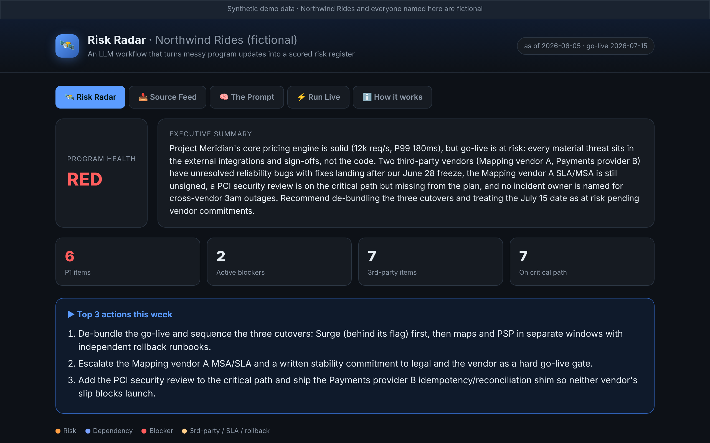
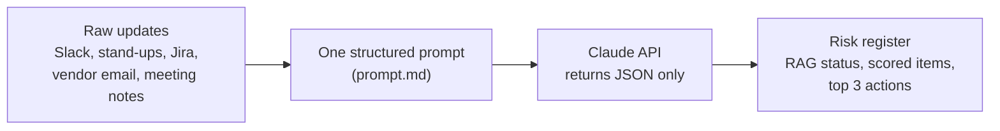
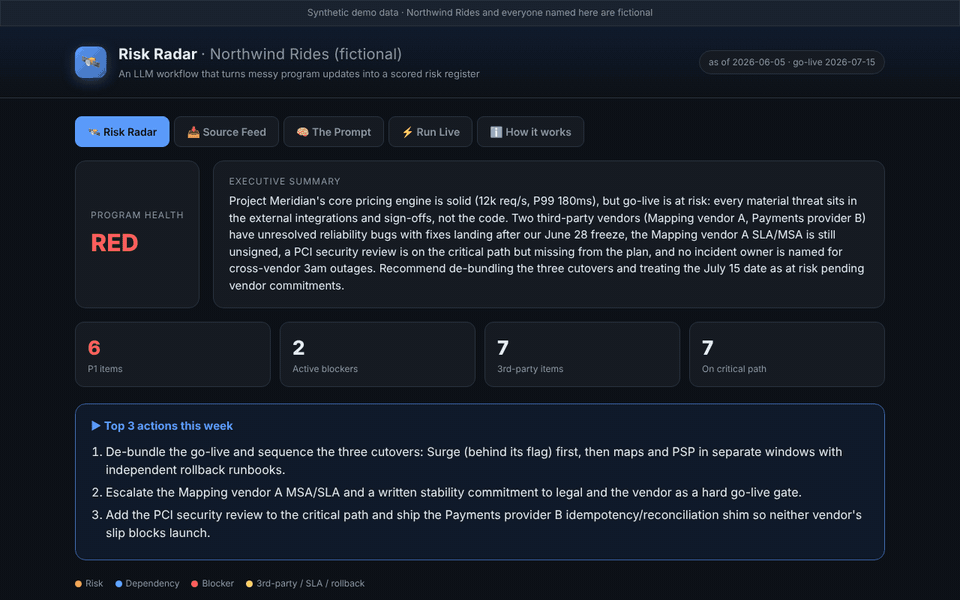

# Risk Radar

An LLM workflow that turns messy program updates into a scored risk register, with an owner, a severity and a source for every item.

**Live demo:** https://husameltahir.github.io/risk-radar/ (works with no API key)

## The problem

Program updates arrive as Slack threads, stand-up notes, Jira comments and vendor emails; risks hide in them. A vendor bug in one channel and a freeze date in another only become a go-live threat when someone reads both. Third-party integrations are where this hurts most, because SLAs, incident ownership and rollback sit across an organisation boundary that nobody owns by default.

## How it works

1. **Input.** Each update is one line with an ID and its source, for example `[U-002] (Standup notes, Omar (PSP Integration)) Refund webhook is flaky...`. The demo ships ten synthetic updates in [`data/program_updates.json`](data/program_updates.json).
2. **Prompt.** [`prompt.md`](prompt.md) is sent as the system prompt. The user message carries the program name, target go-live date, the as-of date and the raw updates.
3. **Output.** The model returns one JSON object. The page renders it as cards with filters (P1 only, blockers, third-party, affects go-live).

### Output schema

| Field | What it holds |
| --- | --- |
| `rag_status` | Overall program health: `RED`, `AMBER` or `GREEN` |
| `executive_summary` | 2 to 3 sentences for a VP audience |
| `headline_metrics` | `p1_count`, `blockers`, `third_party_items`, `items_on_critical_path` |
| `items[].type` | `RISK`, `DEPENDENCY` or `BLOCKER` |
| `items[].severity` | `P1` to `P4` (P1 threatens go-live or causes customer or financial impact) |
| `items[].owner` | Named in the source, or the most likely role marked "(inferred)" |
| `items[].is_third_party`, `affects_go_live`, `on_critical_path` | Boolean flags |
| `items[].sla_or_rollback_note` | Required when `is_third_party` is true: the SLA, incident-ownership or rollback implication; otherwise `null` |
| `items[].recommended_action` | One concrete next step |
| `items[].confidence` | 0.0 to 1.0 |
| `items[].source_ids` | The update IDs the item came from |
| `items[].linked_ids` | Other updates that compound the item |
| `top_3_actions_this_week` | Three actions for the program lead |

The pre-computed run the demo shows is in [`data/analysis.json`](data/analysis.json).

## Try it

- **Online:** https://husameltahir.github.io/risk-radar/
- **Risk Radar** and **Source Feed** tabs show the pre-computed run straight away.
- **Run Live** sends your own notes (or the sample) to the Claude API from your browser. Paste your own Anthropic API key. The key stays in this browser tab and is sent only to the model API: it is held in a JavaScript variable, never written to local storage, session storage, cookies or the URL, and is gone when the tab closes.

## Run locally

Download or clone the repo and open `index.html` in a browser. There is no build step and no server. The data and prompt are embedded in the page, so it also works from `file://`.

To publish your own copy, the workflow in `.github/workflows/deploy-pages.yml` deploys the repo to GitHub Pages on every push to `main` (set Settings, Pages, Source to "GitHub Actions").

## Prompt design notes

- **Evidence first.** Every item must cite `source_ids`, and the prompt forbids facts, dates, names or numbers that are not in the input. A reviewer can check any card against the Source Feed.
- **Third-party items cannot skip the hard question.** If `is_third_party` is true, `sla_or_rollback_note` is mandatory. This is the field that surfaces an unsigned SLA, a rollback that needs a vendor-side cache flush, or an outage with no named incident owner.
- **One label per item.** `RISK`, `DEPENDENCY` and `BLOCKER` are defined in the prompt (could go wrong, waiting on someone, stopping progress now) so the classification is repeatable.
- **Severity has a written scale.** P1 to P4 are defined in terms of go-live impact and urgency, not left to the model's sense of importance.
- **Owners are honest.** An owner the source does not name is marked "(inferred)".
- **Connections are explicit.** `linked_ids` records when two updates compound, for example a vendor fix that lands after the go-live freeze.
- **JSON only.** No markdown or preamble, so the output can feed a Jira sync, a weekly email or a dashboard without clean-up. The page still strips stray code fences before parsing.

## Limitations

- The data is synthetic. Northwind Rides, Project Meridian, the people and the vendors are all made up.
- `headline_metrics` are counted by the model, not recomputed by the page, so they can drift from the item list. (The original pre-computed run had this drift; the counts in `data/analysis.json` were corrected to match its items.)
- The page does not validate the response against the schema or check that each `source_id` exists in the input.
- Live calls go straight from the browser to the API. Use a key with a spend limit, and only on a page you trust.
- `max_tokens` is 4,000. The demo's 10-item output is about 8 KB of JSON; much larger inputs may be cut off.
- The whole of `prompt.md`, including its introduction and the user-message template, is sent as the system prompt.
- There is no evaluation set yet, so output quality is judged by reading it.

## Files

| File | Purpose |
| --- | --- |
| `index.html` | The whole app: dashboard, source feed, prompt viewer and live mode |
| `prompt.md` | The system prompt and output schema |
| `data/program_updates.json` | Synthetic multi-source updates (the page embeds a copy) |
| `data/analysis.json` | The pre-computed output the demo renders (the page embeds a copy) |
| `.github/workflows/deploy-pages.yml` | GitHub Pages deployment |

## Status

Working demo. Possible next steps: Slack and Jira connectors, scheduled runs, and a diff against the last run to flag new and escalating risks.

## Licence

MIT. See [LICENSE](LICENSE).
